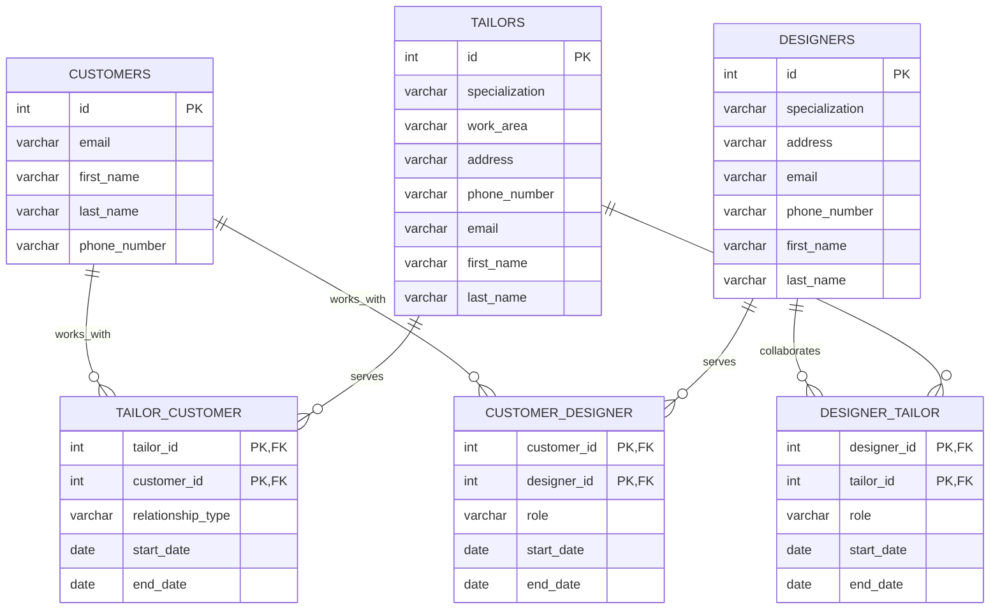

# Tailoring Management System

A relational database project developed using **MySQL** to manage customers, tailors, fashion designers, and their professional relationships.

## Project Overview

The Tailoring Management System is designed to organize information about customers, tailors, and designers. It uses a relational database structure to maintain connections between these entities through many-to-many relationships.

The database provides a foundation for managing customer relationships, tailor assignments, designer collaborations, and their associated dates and roles.

## Technologies Used

- MySQL 8.0+
- MySQL Workbench
- SQL (Structured Query Language)
- Relational Database Management System (RDBMS)

## Database Structure

The database consists of six tables:

| Table | Description |
|---|---|
| `customers` | Stores customer information |
| `tailors` | Stores tailor information and specializations |
| `designers` | Stores fashion designer information |
| `designer_tailor` | Connects designers with tailors |
| `tailor_customer` | Connects tailors with customers |
| `customer_designer` | Connects customers with designers |

## Entity Relationship Diagram

The database contains three main entities and three relationship tables.



## Main Features

- Customer information management.
- Tailor information and specialization management.
- Fashion designer information management.
- Many-to-many relationships between customers, tailors, and designers.
- Primary key and foreign key constraints.
- Automatic ID generation using `AUTO_INCREMENT`.
- Unique email addresses within each entity table.
- Date validation using `CHECK` constraints.
- Referential integrity using foreign keys.
- Sample records for database testing.
- SQL JOIN queries for retrieving related information.

## Database Relationships

### 1. Designer and Tailor

A designer can collaborate with multiple tailors, and a tailor can work with multiple designers.

Relationship: **Many-to-Many**

### 2. Tailor and Customer

A tailor can serve multiple customers, and a customer can work with multiple tailors.

Relationship: **Many-to-Many**

### 3. Customer and Designer

A customer can work with multiple designers, and a designer can serve multiple customers.

Relationship: **Many-to-Many**

The relationship tables store additional information, including roles, relationship types, and start and end dates.

## How to Run the Project

1. Download or clone this repository.
2. Open MySQL Workbench.
3. Connect to your MySQL server.
4. Open the `tailoring_management.sql` file.
5. Execute the SQL script.
6. Refresh the Schemas panel.
7. Select the `tailoring_management` database.
8. Explore the tables and execute the sample queries.

## Repository Structure

```text
Tailoring-Management-System/
│
├── README.md
│
└── tailoring_management.sql
```

## Learning Objectives

This project demonstrates practical knowledge of:

- Database design and normalization concepts.
- Entity Relationship Diagrams (ERD).
- Primary keys and foreign keys.
- One-to-Many and Many-to-Many relationships.
- SQL table creation and data insertion.
- Referential integrity.
- SQL JOIN operations.
- Database constraints and indexing.

## Future Improvements

Possible extensions include:

- Order management.
- Clothing measurement records.
- Payment and invoice management.
- Appointment scheduling.
- Fabric and inventory management.
- Customer order history.
- Reporting and analytics dashboard.

## Author

**Iftikhar Arif**

MS Data Science Student | Statistics Graduate

GitHub: [@Iftikhararif125](https://github.com/Iftikhararif125)

---

*This project was developed for database design and SQL learning purposes.*
